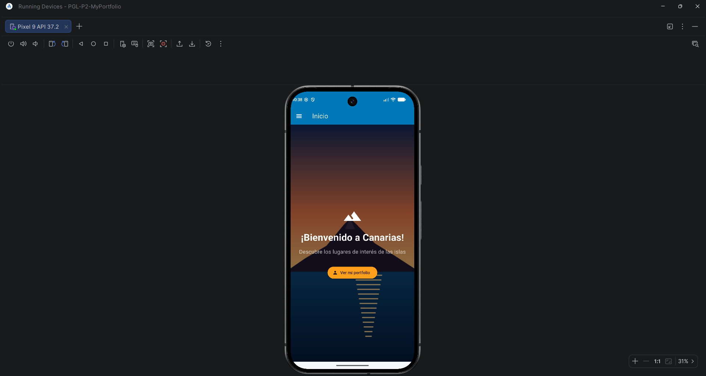
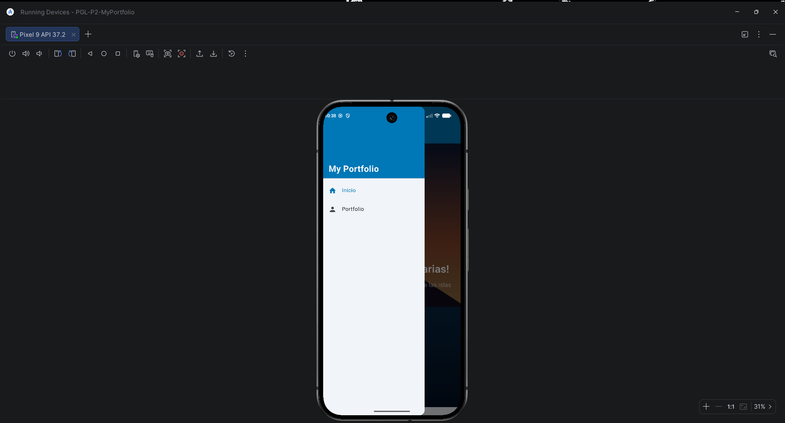
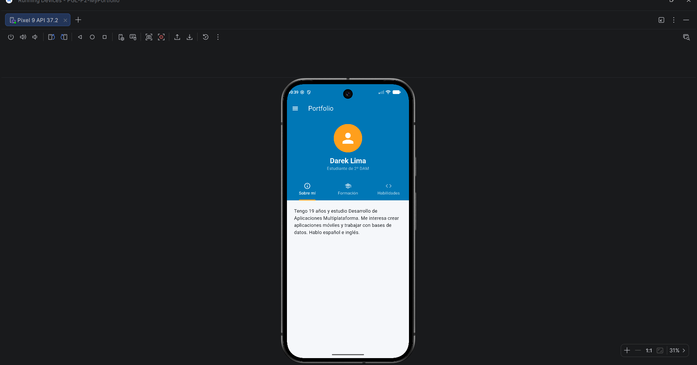

# PGL-P2-MyPortfolio

App Flutter de turismo en Canarias (lugares de interés) con navegación por
**Drawer** usando **go_router**.

## Funcionalidades

- Navegación lateral (Drawer) con `go_router` y `ShellRoute`.
- **Pantalla de bienvenida** con imagen de fondo y mensaje.
- **Portfolio personal** con pestañas (Sobre mí, Formación, Habilidades),
  con los colores de la paleta del nuevo diseño.

## Estructura

```
lib/
├── main.dart
├── router/app_router.dart      # rutas go_router
├── theme/app_theme.dart        # paleta de colores y tema
├── widgets/
│   ├── app_shell.dart          # Scaffold + AppBar + Drawer
│   └── app_drawer.dart         # menú lateral
└── screens/
    ├── welcome_screen.dart
    └── portfolio_screen.dart
```

## Ejecutar

```bash
flutter pub get
flutter run
```

## Capturas

| Bienvenida | Drawer | Portfolio |
|---|---|---|
|  |  |  |
